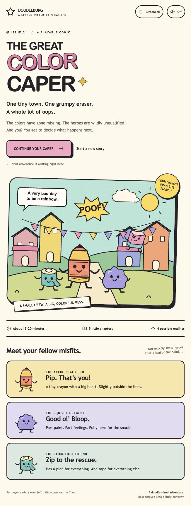

# Stowry · The Great Color Caper

A colorful, story-first comic adventure through Doodleburg. Play as Pip, an accidental crayon hero, and follow a crew of art-supply misfits as they try to save their town's colors.

## Preview



## The adventure

- Five chapters and roughly 3,000 words per playthrough (about 15–20 minutes, depending on reading pace).
- Branching choices, a selectable companion, conditional dialogue, and four endings.
- Three gentle puzzles with hints and unlimited retries.
- Original SVG artwork, animation, optional sound effects, and a responsive layout.
- A scrapbook of clues and discovered endings, saved automatically in the browser.
- Keyboard controls and support for reduced-motion preferences.

## Run locally

Requirements: Python 3 for the preview server. Node.js 18 or newer for the tests.

```sh
git clone https://github.com/samidun26/stowry.git
cd stowry
npm start
```

Open http://127.0.0.1:4187 in your browser. No dependency installation or build step is required. Without npm, run:

```sh
python3 -m http.server 4187 --bind 127.0.0.1 --directory dist
```

Use a local HTTP server rather than opening `dist/index.html` directly, because the source version uses browser modules.

## Check the story

```sh
npm test
```

The checks explore all 3,568 available routes, visit all 24 story scenes, confirm that all four endings are reachable, and validate scene references, conditional prose, and saved-state serialization.

Browser verification covered a complete playthrough, all three puzzles, wrong-answer recovery, save/resume after reloading, the scrapbook, and desktop and mobile layouts.

## Project files

| File | Purpose |
| --- | --- |
| `dist/index.html` | Game entry point |
| `dist/app.js` | Comic reader, choices, puzzles, saving, scrapbook, and sound |
| `dist/story.js` | Story content, branches, state transitions, and endings |
| `dist/art.js` | Original vector characters and scenery |
| `dist/style.css` | Responsive layout and animation |
| `tests/check-story.mjs` | Exhaustive story-route checks |

## Hosting and saves

The `dist` directory can be served by any static website host. This repository contains the source; publishing a hosted game is a separate step.

Progress is saved locally in the browser and is not synced across devices or website addresses. Clearing browser data clears saved progress. Sound effects are off by default. The game has no external assets, analytics, backend, or runtime dependencies.
